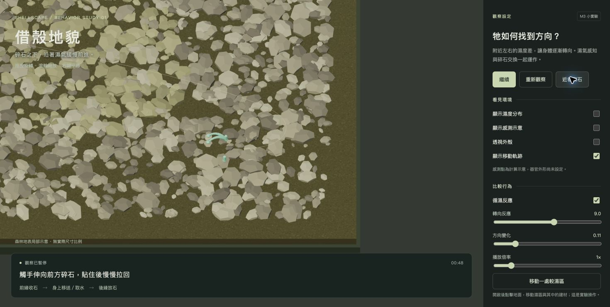

# M3 個體

## 2026-10-22｜Braitenberg 循濕行為小實驗

Luna 已要求先試第 1 種感測轉向，並明確選擇網頁版。這版以薄小本體、前收後放碎石、循濕移動與接觸建材取水作為第一個可操作實驗。

### 開啟

在 repo 根目錄執行：

```sh
python3 -m http.server 8765 --bind 127.0.0.1
```

瀏覽器開啟 <http://127.0.0.1:8765/m3-creature/>。使用已在 repo 的 Three.js 0.180.0 與 OrbitControls，不需 npm 或 CDN；依賴與 MIT 授權保留在 `../m2-species/vendor/`，請保留這個資料夾。不可直接雙擊 HTML 以 file:// 執行。



### 怎麼觀察

目前地面有 3,900 顆碎石，其中新增 2,420 顆較細的小碎石。「近看取石」預設開啟並跟隨生物，可切換回全景。

1. 打開「顯示濕度分布」與「顯示感測示意」，比較左右濕度指標與轉彎。數字是 0～1 的示意指標，不是實測相對濕度。
2. 切換「循濕反應」作對照；可調轉向反應、方向變化及播放倍率。
3. 開啟「移動一處較濕區」，再點地面，會移動第一處濕區和其中未被拾起的建材；這是實驗控制，不是生物能力。
4. 觀察觸手伸出、貼住石頭、拉回身前，再沿身體移送到後方放回，以及取水累計。最多四條取石觸手同時伸展，這是動作展示參數；觸手不等於先前延後討論的濕氣感知器官。每塊碎石只有一份狀態，不會因拾取或放回而新增石塊；初始已有 16 塊在身上，故開始時放回數可比新拾取數多。
5. 用「透視外殼」查看薄小本體。預設隱藏本體網格、只呈現碎石，是這輪觀看效果的簡化；不是完整驗證了石塊的物理遮蔽。

### 程式做了什麼

- `simulation.mjs`：先比較左右附近的濕度，把同側驅動調弱，左右差帶動轉向，再加入少量連續方向變化；接觸建材後，於附著期間取完其儲水，從後方放回。
- `sketch.mjs`：建立局部碎石地面、畫出拾取／放回、濕度覆蓋圖及感測、軌跡與操作介面。
- `style.css`、`index.html`：頁面與控制項。取樣點只是計算位置，尚未決定感知器官外形或個數。
- 演算法參考：[Braitenberg 開源實作](https://github.com/Mostly1sAnd0s/vehicles)；來源與其他候選比較見 [algorithm-comparison.md](algorithm-comparison.md)。本輪依概念另寫簡化邏輯，沒有匯入該專案程式或依賴。

### 驗證與界線

- `node --check` 檢查兩份程式與 `git diff --check` 通過。
- `node --test m3-creature/simulation.test.mjs` 四項通過：左右濕區對調與關閉循濕的控制、180 秒模擬的碎石／水量守恆與放回前取水完成、暫停及移動濕區時的狀態維持、觸手接觸前石頭不移動且完成拉回後才計入拾取。
- Chrome 已實際載入 3D、觀察取水累計增加，操作濕度圖、感測、透視、循濕對照、倍率、濕區移動、暫停與重新觀察；軌跡緩衝區問題已修正，新分頁持續操作後的 warning/error 清單為空，詳見 [卡點與解法](debug-note.md)。
- 這是局部地表實驗，濕度場、取水速度、建材分布、薄膜尺寸與觀察區邊緣導回都是測試參數；沒有模擬實際濕氣傳播、石塊碰撞、高溫腐蝕、能量、體內儲水上限或繁殖。
- 本版為依 Luna 描述做的第一輪實驗，仍需 Luna 親自檢視動作與採用範圍；未宣稱本人閱讀、反思、老師檢核或完整 M3 交付完成。

AI：Codex；2026-10-22；Prompt 摘要：先用第 1 種演算法試作，選擇網頁版；採用範圍：依 Luna 的生物描述實作轉向、地面石塊交換、接觸取水、介面與對照開關、程式測試、Chrome 實測與卡點紀錄。使用既有 Three.js 本地依賴，新增程式與參數由 AI 實作。未代寫本人反思、創作理由或研究結論。

追加 AI 揭露：依 Luna 要求增加細碎石、強化伸觸手拿石頭的動作；新增分段取石狀態、可見彎曲觸手與近看跟隨視角，延長取石過程方便觀察。此為動作示意，未新增真實受力或感知器官設定。未代寫反思。

> 截止：11/12（四）上課前 15:30
> 這一站在做什麼、怎麼做、卡住看哪裡，都在課程頁：<https://course.interaction.tw/oop/#milestones>

> 這一站是**報告站**：每個人上台三分鐘，簡報一律轉成 PDF 放這個資料夾。

讓牠有天性：會對環境反應，看得出是活的。

## 這一站要交的四件套

- [ ] 程式碼：有行為的個體
- [ ] 截圖或影片：牠對環境反應的樣子
- [ ] 反思：下面那段，一百到兩百字，自己寫
- [ ] AI 揭露欄：下面的表格
- [ ] 簡報 PDF：檔名 `m3-簡報.pdf`，放這個資料夾裡（物種發表會）

## 反思

（一百到兩百字，自己寫，AI 不代寫：你這一站做了什麼、卡在哪、怎麼解的、下一站想改什麼。）

## AI 揭露欄

| 項目 | 內容 |
|------|------|
| 工具 | （例：agy／Claude Code／Codex／未使用） |
| 日期 | |
| prompt 摘要 | |
| 採用範圍 | （哪些碼、哪些想法來自 AI，你自己改了什麼） |

## 課前準備與物種日誌

過程中的筆記、查到的資料、想到一半的點子，寫在這個資料夾的 `notes.md`（需要時自己建，格式自由）。

### 2026-10-22 課前準備與 AI 揭露

- [GitHub 五種移動演算法比較](algorithm-comparison.md)：Braitenberg、Run-and-Tumble、Physarum 三方向感測、Wander、人工勢場。Codex 依 Luna 要求搜尋、核對原碼及專案現況，整理優缺點；後續已按第 1 種進行上方網頁小實驗，其餘候選未實作，未代寫本人反思或設計理由。
- 本週盤點、既有模型對照、候選卡點與 Reynolds 閱讀指引見 [notes.md](notes.md)。Luna 已確認本體小而薄、充滿水分、從吸水建材補水，以及前收後放碎石的代表動作；已授權的網頁實驗見上方，模型採用範圍仍待本人確認，未宣稱全部 M3 作業完成。
- 工具：Codex；日期：2026-10-22；Prompt 摘要：一起完成這週任務；採用範圍：核對進度、程式檢查、研究比較與一維數值實驗、課前準備筆記。未代寫本人反思或設計理由。
- 本輪補充：依 Luna 原文保存本體、補水來源與移動設定，標記既有程式的差距；未修改生物程式，未代寫反思。
- 後續確認：吸水建材在附著期間即被吸完儲水，之後照常放回環境，不另外留在身上；僅更新討論紀錄，未實作取水系統。
- 後續確認：移動途中接觸建材才吸水；沒有眼睛。Luna 再補充體內有感知濕氣的器官，會緩慢、不規則地往較潮濕方向移動，器官構造仍延後討論。環境確認為長時間少雨、土壤仍濕潤但各處濕度不同。Codex 依此整理描述、核對 Wander 與 Flow Field Following 原典，未修改程式，詳見 notes.md。
