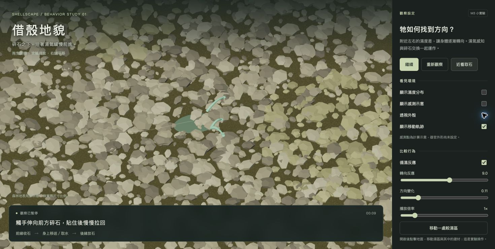

# M3 個體

## 2026-11-19｜公開網頁

公開入口：<https://lunaa0119.github.io/repo/m3-creature/>。訪客直接用瀏覽器載入互動觀察室，不需要安裝工具或開啟本機伺服器。頁面另附已確認的完整物種設定文件連結。

原始碼保存在 `main`，公開網頁由獨立的 `gh-pages` 分支提供。發布前執行 `node --test m3-creature/ecosystem.test.mjs m3-creature/simulation.test.mjs`，再用 `python3 m3-creature/prepare-pages.py <新的空資料夾>` 整理網頁、字體及 Three.js 依賴，提交並推送該資料夾至 `gh-pages`。只更新 main 不會自動更新公開網站。

網站根網址會轉往觀察室；本機錄影伺服器、筆記及測試檔不包含在網站發布包中。一般錄影按鈕透過瀏覽器下載影片；本機逐格匯出仍需本機工具。採用分支發布是因現有 GitHub 授權未包含新增 Actions 工作流程的權限。

AI 揭露：Codex；2026-11-19；Prompt 摘要：將現有石殻姆資料與互動網頁上傳 GitHub，完成可公開開啟的網址；採用範圍：既有版本整理、GitHub Pages 發布流程、設定文件入口、測試與公開網址驗證。未新增生物設定，未代寫本人反思或設計理由。發布驗證結果見 notes.md 最新紀錄。

## 2026-11-12｜石殻姆・水循環觀察室

### 無字活動影片

依 Luna 指示，已在桌面「物件導向式程式設計/石殻姆活動影片」輸出 `石殻姆-活動與環境展示-v2.mp4`：52 秒、1280 × 720、24 fps、無文字、字幕與音訊。影片直接使用本頁 WebGL 場景，展示移動取石、分離新個體、日照失水微縮及遇雨恢復；AVFoundation 解碼與抽幀檢視通過。製作與驗證紀錄同目錄保留，未將影片加入 repo。

網頁新增「錄製無字活動影片」按鈕；錄製時應保持分頁可見。`record-film.mjs` 提供畫布錄製，`record-frames.mjs` 與 `recording-server.py` 提供本機逐格輸出，解決背景錄製降至 1 fps 的情況。錄影僅包含 3D 畫布，不包含 DOM 文字或控制台。

AI 揭露追加：Codex；2026-11-12；依本人「不要有字、像錄下網頁操作」的要求製作 3D 無字影片，協助錄製功能、情境排程、逐格輸出、macOS MP4 編碼與驗證。沿用既有模型與本人設定，未代寫反思或創作理由；影片僅存本機。

Luna 已確認更新原 M3 行為版，將當日設定接進互動網頁，並提供深色透明薄膜的視覺參考。新版加入吸水成長、薄膜分離、多個體自行撿石、日照失水、石殼遮蔽、100 mL 以下微縮休眠，以及降雨補水恢復。完整參數、取捨、驗證和待辦見 [本輪更新紀錄](2026-11-12-update.md)。

### 開啟新版

在 repo 根目錄執行 `python3 m3-creature/launch.py`，或雙擊桌面課程資料夾的「開啟石殻姆觀察室.command」。原本的 `python3 -m http.server 8765 --bind 127.0.0.1` 方式也可使用，網址仍是 <http://127.0.0.1:8765/m3-creature/>。

### 先觀察的功能

1. 「看分裂」載入容量已滿的濕潤情境；新個體分離後立即活動，沒有親體分配的石殼。可用「觀察個體」切換。
2. 「看休眠」載入缺水情境；打開降雨，將已有水氣送回地表，觀察微縮個體吸水恢復。
3. 調整日照，比較體內水量與石殼遮蔽；地表、體內和環境水氣共同維持有限水量帳本。
4. 「環境與觀察工具」保留舊控制；分裂容量可調，預設 260 mL、新個體暫分得 110 mL，皆已標為展示參數。約滑鼠大小仍未換算為實際比例。

新版使用 `ecosystem.mjs` 計算生命循環、`specimen-visual.mjs` 呈現薄膜與分離、`habitat.css` 呈現深色觀察介面。原 `simulation.mjs` 與舊測試保留作歷史比較。材質採用本機 Three.js，文字用源雲明體，授權保存在 `assets/`。

測試：`node --test m3-creature/ecosystem.test.mjs m3-creature/simulation.test.mjs`，新增 8 項與舊版 5 項共 13 項通過。Chrome 曾顯示新版 3D 與水量介面；最後瀏覽器控制受工具連線錯誤中斷，完整情境按鈕及最後材質效果仍待本人檢視。這是生命循環與材質試版，沒有宣稱完成寫實 3D、完整生理或課程交付。

AI 揭露：Codex；2026-11-12；Prompt 摘要：依今日生物設定更新既有 M3 網頁、採用本人提供的畫面參考；採用範圍：計算模組、互動、UI、材質／光線、測試、備份、啟動器與文件。生物設定由 Luna 提供，展示參數與待決問題分開；未代寫本人反思、設計理由或研究結論。本次僅存本機，未提交或推送。

## 2026-10-22｜Braitenberg 循濕行為小實驗

Luna 已要求先試第 1 種感測轉向，並明確選擇網頁版。這版以薄小本體、前收後放碎石、循濕移動與接觸建材取水作為第一個可操作實驗。

今日設定、程式與修改、驗證、作業完成狀態及下一步，集中整理在 [2026-10-22 今日統整](2026-10-22-summary.md)。

### 開啟

在 repo 根目錄執行：

```sh
python3 -m http.server 8765 --bind 127.0.0.1
```

瀏覽器開啟 <http://127.0.0.1:8765/m3-creature/>。使用已在 repo 的 Three.js 0.180.0 與 OrbitControls，不需 npm 或 CDN；依賴與 MIT 授權保留在 `../m2-species/vendor/`，請保留這個資料夾。不可直接雙擊 HTML 以 file:// 執行。



### 怎麼觀察

目前地面有 3,900 顆碎石，其中新增 2,420 顆較細的小碎石。「近看取石」預設開啟並跟隨生物，可切換回全景。

依 Luna 最後回饋，基本移動速度已從 0.48 調為 0.28，約慢四成；觸手拿石、放石的節奏保留，播放倍率預設仍為 1×。

1. 打開「顯示濕度分布」與「顯示感測示意」，比較左右濕度指標與轉彎。數字是 0～1 的示意指標，不是實測相對濕度。
2. 切換「循濕反應」作對照；可調轉向反應、方向變化及播放倍率。
3. 開啟「移動一處較濕區」，再點地面，會移動第一處濕區和其中未被拾起的建材；這是實驗控制，不是生物能力。
4. 觀察前方觸手伸出、貼住石頭、拉回身前，再沿身體移送；後方細觸手托住碎石、放到地面、鬆開收回。石頭落地後才增加放回計數。畫面最多同時顯示四條前方、八條後方觸手，這是動作展示參數；觸手不等於先前延後討論的濕氣感知器官。每塊碎石只有一份狀態，不會因拾取或放回而新增石塊；初始已有 16 塊在身上，故開始時放回數可比新拾取數多。
5. 薄小本體預設顯示，會被上方碎石部分遮蔽。「透視外殼」只調整碎石透明度，方便查看身體與取石動作，不會將身體隱藏。

### 程式做了什麼

- `simulation.mjs`：先比較左右附近的濕度，把同側驅動調弱，左右差帶動轉向，再加入少量連續方向變化；接觸建材後，於附著期間取完其儲水，從後方放回。
- `sketch.mjs`：建立局部碎石地面、畫出拾取／放回、濕度覆蓋圖及感測、軌跡與操作介面。
- `style.css`、`index.html`：頁面與控制項。取樣點只是計算位置，尚未決定感知器官外形或個數。
- 演算法參考：[Braitenberg 開源實作](https://github.com/Mostly1sAnd0s/vehicles)；來源與其他候選比較見 [algorithm-comparison.md](algorithm-comparison.md)。本輪依概念另寫簡化邏輯，沒有匯入該專案程式或依賴。

### 驗證與界線

- `node --check` 檢查兩份程式與 `git diff --check` 通過。
- `node --test m3-creature/simulation.test.mjs` 五項通過：左右濕區對調與關閉循濕的控制、180 秒模擬的碎石／水量守恆與放回前取水完成、暫停及移動濕區時的狀態維持、觸手接觸前石頭不移動且完成拉回後才計入拾取、後方觸手逐步放石且落地後原地不動並只計數一次。
- Chrome 已實際載入 3D、觀察取水累計增加，操作濕度圖、感測、透視、循濕對照、倍率、濕區移動、暫停與重新觀察；軌跡緩衝區問題已修正，新分頁持續操作後的 warning/error 清單為空，詳見 [卡點與解法](debug-note.md)。
- 這是局部地表實驗，濕度場、取水速度、建材分布、薄膜尺寸與觀察區邊緣導回都是測試參數；沒有模擬實際濕氣傳播、石塊碰撞、高溫腐蝕、能量、體內儲水上限或繁殖。
- 本版為依 Luna 描述做的第一輪實驗，仍需 Luna 親自檢視動作與採用範圍；未宣稱本人閱讀、反思、老師檢核或完整 M3 交付完成。

AI：Codex；2026-10-22；Prompt 摘要：先用第 1 種演算法試作，選擇網頁版；採用範圍：依 Luna 的生物描述實作轉向、地面石塊交換、接觸取水、介面與對照開關、程式測試、Chrome 實測與卡點紀錄。使用既有 Three.js 本地依賴，新增程式與參數由 AI 實作。未代寫本人反思、創作理由或研究結論。

追加 AI 揭露：依 Luna 要求增加細碎石、強化伸觸手拿石頭的動作；新增分段取石狀態、可見彎曲觸手與近看跟隨視角，延長取石過程方便觀察。此為動作示意，未新增真實受力或感知器官設定。未代寫反思。

外觀修正 AI 揭露：依 Luna 後續回饋，把取石觸手與末端接觸點的粗細縮為前版約三分之一，保留長度與動作；未代寫反思。

後方動作 AI 揭露：依 Luna 要求新增細觸手托石、放下、收回的分段動作；落地位置固定、石頭落地才計入放回，收手時不拖動已放好的石頭。維持縮細後的觸手粗細，未代寫反思。

今日收尾 AI 揭露：依 Luna 要求調慢基本移動速度、重新核對課程進度、整理今日統整與剩餘待辦，並同步 GitHub；未代寫本人反思。

> 截止：11/12（四）上課前 15:30
> 這一站在做什麼、怎麼做、卡住看哪裡，都在課程頁：<https://course.interaction.tw/oop/#milestones>

> 這一站是**報告站**：每個人上台三分鐘，簡報一律轉成 PDF 放這個資料夾。

讓牠有天性：會對環境反應，看得出是活的。

## 這一站要交的四件套

- [x] 程式碼：有行為的個體（本輪小實驗，採用範圍待本人確認）
- [x] 截圖或影片：牠對環境反應的樣子（實際截圖 preview.png）
- [ ] 反思：下面那段，一百到兩百字，自己寫
- [x] AI 揭露欄：下面的表格
- [ ] 簡報 PDF：檔名 `m3-簡報.pdf`，放這個資料夾裡（物種發表會）

## 反思

（一百到兩百字，自己寫，AI 不代寫：你這一站做了什麼、卡在哪、怎麼解的、下一站想改什麼。）

## AI 揭露欄

| 項目 | 內容 |
|------|------|
| 工具 | Codex、GitHub CLI、Chrome、Node |
| 日期 | 2026-10-22 |
| prompt 摘要 | 完成本週準備；整理生物設定、研究五種演算法並試作 Braitenberg 網頁，依本人回饋修改碎石、前後細觸手、本體顯示與速度，整理上傳 |
| 採用範圍 | Luna 提供設定、選擇與操作回饋；AI 協助研究、實作、測試、除錯、截圖、文件與 Git 提交。未代寫本人反思或研究結論，詳見今日統整 |

## 課前準備與物種日誌

過程中的筆記、查到的資料、想到一半的點子，寫在這個資料夾的 `notes.md`（需要時自己建，格式自由）。

### 2026-10-22 課前準備與 AI 揭露

- [GitHub 五種移動演算法比較](algorithm-comparison.md)：Braitenberg、Run-and-Tumble、Physarum 三方向感測、Wander、人工勢場。Codex 依 Luna 要求搜尋、核對原碼及專案現況，整理優缺點；後續已按第 1 種進行上方網頁小實驗，其餘候選未實作，未代寫本人反思或設計理由。
- 本週盤點、既有模型對照、候選卡點與 Reynolds 閱讀指引見 [notes.md](notes.md)。Luna 已確認本體小而薄、充滿水分、從吸水建材補水，以及前收後放碎石的代表動作；已授權的網頁實驗見上方，模型採用範圍仍待本人確認，未宣稱全部 M3 作業完成。
- 工具：Codex；日期：2026-10-22；Prompt 摘要：一起完成這週任務；採用範圍：核對進度、程式檢查、研究比較與一維數值實驗、課前準備筆記。未代寫本人反思或設計理由。
- 本輪補充：依 Luna 原文保存本體、補水來源與移動設定，標記既有程式的差距；未修改生物程式，未代寫反思。
- 後續確認：吸水建材在附著期間即被吸完儲水，之後照常放回環境，不另外留在身上；僅更新討論紀錄，未實作取水系統。
- 後續確認：移動途中接觸建材才吸水；沒有眼睛。Luna 再補充體內有感知濕氣的器官，會緩慢、不規則地往較潮濕方向移動，器官構造仍延後討論。環境確認為長時間少雨、土壤仍濕潤但各處濕度不同。Codex 依此整理描述、核對 Wander 與 Flow Field Following 原典，未修改程式，詳見 notes.md。
